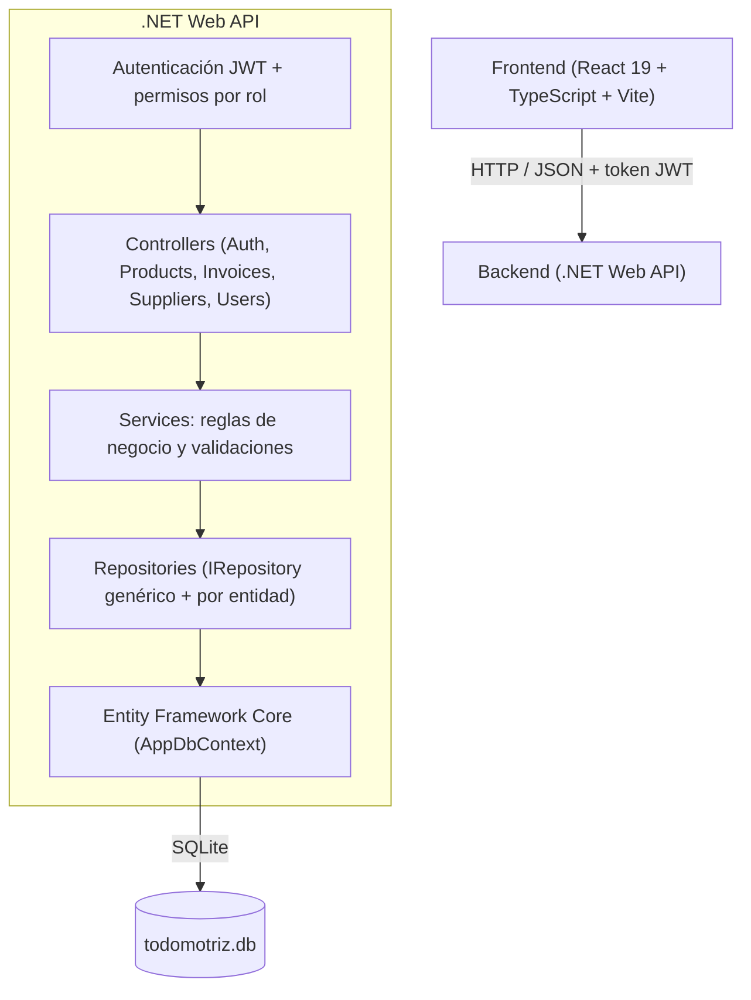

# 🚗 Todomotriz - Sistema Integral de Gestión de Taller y Repuestos Automotrices

Sistema completo de gestión y punto de venta diseñado para talleres mecánicos y tiendas de repuestos automotrices. Permite administrar de forma centralizada inventario, facturación con descuento automático de stock, control de proveedores, usuarios con roles jerárquicos (RBAC) y métricas en tiempo real mediante un dashboard interactivo.

---

## 📋 Tabla de Contenidos

- [Características Principales](#-características-principales)
- [Tecnologías Utilizadas](#-tecnologías-utilizadas)
- [Arquitectura del Sistema](#-arquitectura-del-sistema)
- [Roles y Matriz de Permisos](#-roles-y-matriz-de-permisos)
- [Credenciales de Prueba (Seed Data)](#-credenciales-de-prueba-seed-data)
- [Requisitos Previos](#-requisitos-previos)
- [Instalación y Puesta en Marcha](#-instalación-y-puesta-en-marcha)
  - [Opción 1: Inicio Rápido (Windows)](#opción-1-inicio-rápido-script-startbat)
  - [Opción 2: Inicio Manual](#opción-2-inicio-manual)
- [Estructura del Proyecto](#-estructura-del-proyecto)
- [Documentación de la API (REST)](#-documentación-de-la-api-rest)
- [Flujos Clave del Negocio](#-flujos-clave-del-negocio)

---

## ✨ Características Principales

- **📊 Dashboard Interactivo**:
  - Métricas clave en tiempo real: productos en stock, facturas del mes, proveedores activos y usuarios registrados.
  - Cálculo automático de ventas del día en estado pagado.
  - Alertas prioritarias: productos con stock igual o inferior al mínimo y facturas pendientes de cobro.

- **📦 Gestión de Inventario**:
  - Catálogo completo con código único, nombre, categoría, ubicación física (estantes/pasillos), precios de costo y venta.
  - Control de existencias y umbral de stock mínimo con indicadores visuales.
  - Búsqueda dinámica y filtrado de productos.

- **🧾 Facturación y Ventas**:
  - Emisión de facturas con cálculo en vivo de subtotal, IVA (16%) y total.
  - Registro de cliente con documento de identidad adaptado al formato venezolano (V, J, E, G).
  - Registro del vehículo asociado (modelo y placa).
  - Selección dinámica de ítems con validación de stock disponible.
  - **Descuento automático de inventario** en base de datos al generar la factura.
  - Gestión de estados de factura: *Pagada*, *Pendiente*, *Anulada*.
  - Vista previa de factura en formato para impresión.

- **🚚 Gestión de Proveedores**:
  - Ficha completa de proveedores: RIF/Cédula, contacto, teléfonos con códigos de área locales/móviles (0412, 0414, 0424, 0416, 0426, 0212), correo electrónico y dirección.
  - Catálogo asociado a productos del inventario.

- **👥 Control de Acceso Basado en Roles (RBAC)**:
  - Sistema de autenticación con usuarios activos/inactivos.
  - Tres niveles jerárquicos: **Administrador**, **Gerente** y **Empleado**.

---

## 🛠 Tecnologías Utilizadas

### Backend
- **Lenguaje & Framework**: C# con .NET 10 (ASP.NET Core Web API).
- **ORM**: Entity Framework Core 8 con SQLite.
- **Seguridad**: autenticación JWT (`Microsoft.AspNetCore.Authentication.JwtBearer`), contraseñas con hash (`PasswordHasher` de ASP.NET Core) y permisos por rol en cada endpoint.
- **Documentación API**: Swagger / OpenAPI (Swashbuckle) con botón *Authorize* para probar con el token.
- **Patrones**: Arquitectura en capas (Controllers → Services → Repositories) y Repository Pattern. Las reglas de negocio viven en los servicios.
- **Base de Datos**: SQLite (`backend/todomotriz.db`).

### Frontend
- **Framework**: React 19 con TypeScript y Vite.
- **Estilos & UI**: Tailwind CSS, Radix UI Primitives, Lucide React (iconografía).
- **Componentes**: Tablas con filtros y búsqueda, diálogos modales, avisos (toasts), tema claro/oscuro.
- **Tipografía**: Barlow y Barlow Condensed (incluidas localmente, funcionan sin internet).
- **Manejo de Estado**: React Context API (`AuthContext`); la sesión (con su token JWT) se guarda en LocalStorage y se cierra sola al vencer.

---

## 📐 Arquitectura del Sistema



---

## 🔐 Roles y Matriz de Permisos

La matriz se aplica en el frontend (qué botones se ven) **y en el backend** (cada endpoint exige el rol; una petición sin permiso recibe `403`):

| Módulo | Acción | Administrador (`admin`) | Gerente (`gerente`) | Empleado (`empleado`) |
| :--- | :--- | :---: | :---: | :---: |
| **Inventario** | Ver Catálogo | ✅ | ✅ | ✅ |
| | Crear Producto | ✅ | ✅ | ❌ |
| | Editar Producto | ✅ | ✅ | ❌ |
| | Eliminar Producto | ✅ | ❌ | ❌ |
| **Facturación** | Ver Facturas | ✅ | ✅ | ✅ |
| | Crear Factura | ✅ | ✅ | ✅ |
| | Editar / Cobrar Factura | ✅ | ✅ | ❌ |
| | Anular Factura | ✅ | ✅ | ❌ |
| **Proveedores** | Ver Lista | ✅ | ✅ | ✅ |
| | Crear Proveedor | ✅ | ✅ | ❌ |
| | Editar Proveedor | ✅ | ✅ | ❌ |
| | Eliminar Proveedor | ✅ | ❌ | ❌ |
| **Usuarios** | Ver Usuarios | ✅ | ✅ *(solo lectura)* | ❌ |
| | Crear/Editar/Eliminar | ✅ | ❌ | ❌ |

Además, ningún usuario puede desactivarse, eliminarse ni cambiarse el rol a sí mismo.

---

## 🔑 Credenciales de Prueba (Seed Data)

Al iniciarse con una base vacía, el backend la precarga con los datos de `backend/Data/seed-data.json` (o con datos de ejemplo si ese archivo no existe). **Todos los usuarios precargados entran con la contraseña `password123`**:

| Rol | Correo Electrónico | Contraseña |
| :--- | :--- | :--- |
| **Administrador** | `admin@taller.com` | `password123` |
| **Gerente** | `gerente@taller.com` | `password123` |
| **Empleado** | `empleado@taller.com` | `password123` |

> [!NOTE]
> Las contraseñas se guardan cifradas (hash), así que nadie, ni el administrador, puede verlas; el administrador solo puede asignar una nueva. Las bases creadas con versiones anteriores, que tenían las contraseñas en texto plano, se convierten automáticamente la primera vez que arranca la API.

### Actualizar los datos iniciales

Para que un clon nuevo del repositorio arranque con los datos actuales de tu base, exporta la semilla y súbela a git:

```bash
cd backend
dotnet run -- --export-seed
```

Esto escribe `backend/Data/seed-data.json` con proveedores, productos, usuarios (**sin contraseñas**) y facturas, y termina sin levantar la API.

---

## ⚙️ Requisitos Previos

Asegúrate de contar con los siguientes componentes instalados en tu sistema:
- [.NET 10 SDK](https://dotnet.microsoft.com/download)
- [Node.js (v18 o superior)](https://nodejs.org/) y `npm`
- Git (opcional para clonar el repositorio)

---

## 🚀 Instalación y Puesta en Marcha

### Opción 1: Inicio Rápido (Script `start.bat`)

En sistemas operativos Windows, puedes iniciar ambos servicios (Backend y Frontend) de forma automatizada ejecutando el archivo por lotes en la raíz del proyecto:

```cmd
start.bat
```

Este script abrirá automáticamente dos ventanas de consola:
1. **Backend API**: Restaura y ejecuta la API de .NET.
2. **Frontend**: Instala dependencias (`npm install`) y levanta el servidor de desarrollo de Vite.

---

### Opción 2: Inicio Manual

Si deseas ejecutar cada servicio de forma individual:

#### 1. Iniciar el Backend (.NET API)
Desde una terminal en la raíz del proyecto:
```bash
cd backend
dotnet run --project Todomotriz.Api.csproj
```
- La API se iniciará por defecto en `http://localhost:5000`.
- Interfaz interactiva de **Swagger UI**: [http://localhost:5000/swagger](http://localhost:5000/swagger). Para probar endpoints protegidos, inicia sesión con `POST /api/auth/login`, copia el `token` y pégalo en el botón **Authorize**.
- En el primer arranque se genera `backend/jwt-key.txt` (la clave que firma los tokens). No se versiona; si la borras, todas las sesiones abiertas se cierran.

#### 2. Iniciar el Frontend (React + Vite)
En otra terminal desde la raíz del proyecto:
```bash
cd frontend
npm install
npm run dev
```
- La aplicación web estará accesible en [http://localhost:5173](http://localhost:5173).

---

## 📁 Estructura del Proyecto

```text
Todomotriz/
├── Todomotriz.sln             # Solución de Visual Studio para el proyecto .NET
├── start.bat                  # Script para arranque simultáneo de Backend y Frontend
│
├── backend/                   # Proyecto Backend (.NET Web API)
│   ├── Contracts/             # Datos de entrada/salida de la API (login, usuario, factura)
│   ├── Controllers/           # Endpoints REST: solo HTTP y permisos por rol
│   ├── Data/                  # DbContext, SchemaUpdater (migra bases antiguas), seeder y seed-data.json
│   ├── Models/                # Entidades de dominio (User, Product, Supplier, Invoice, InvoiceItem)
│   ├── Repositories/          # Acceso a datos: IRepository genérico + repositorios por entidad
│   ├── Security/              # Roles y emisión de tokens JWT
│   ├── Services/              # Reglas de negocio y validaciones (interfaces I*Service + implementaciones)
│   ├── Program.cs             # Configuración de dependencias, autenticación, CORS, DB y middleware
│   └── Todomotriz.Api.csproj  # Configuración y paquetes NuGet del proyecto .NET
│
└── frontend/                  # Proyecto Frontend (React 19 + TypeScript + Vite)
    ├── public/                # Archivos estáticos
    ├── src/
    │   ├── pages/             # Pantallas, cada una en su carpeta con sus diálogos
    │   │   ├── LoginPage.tsx
    │   │   ├── dashboard/     # Métricas, gráfico de ventas de 7 días y alertas
    │   │   ├── inventario/    # Listado + formulario de producto
    │   │   ├── facturacion/   # Listado, formulario con carrito y comprobante imprimible
    │   │   ├── proveedores/   # Listado + formulario de proveedor
    │   │   └── usuarios/      # Listado, formulario y tabla de roles
    │   ├── components/
    │   │   ├── common/        # Piezas compartidas: encabezados, paneles, filtros, estados, campos
    │   │   ├── feedback/      # Avisos (toasts) y diálogos de confirmación
    │   │   ├── layout/        # Barra lateral, menú móvil y logo
    │   │   └── ui/            # Componentes base (botón, input, select, tabla, diálogo)
    │   ├── contexts/          # AuthContext: sesión, token y matriz de permisos (RBAC)
    │   ├── lib/               # API (con token), formatos, constantes, tema claro/oscuro, carga de datos
    │   ├── types/             # Interfaces TypeScript (Factura, Producto, Usuario, etc.)
    │   ├── App.tsx            # Navegación según autenticación
    │   ├── index.css          # Tokens de diseño (colores claro/oscuro) y estilos de impresión
    │   └── main.tsx           # Punto de entrada (fuentes y tema)
    ├── package.json           # Dependencias de npm y scripts
    ├── tailwind.config.ts     # Tema de Tailwind (lee los tokens de index.css)
    └── vite.config.ts         # Configuración del empaquetador Vite
```

> La base de datos SQLite (`backend/todomotriz.db`) **no se versiona**: haz copias de seguridad de ese archivo por tu cuenta. Si no existe, se crea y precarga automáticamente al iniciar la API.
>
> La URL del backend se puede cambiar creando `frontend/.env` con `VITE_API_URL=http://otra-url:puerto`.

---

## 🌐 Documentación de la API (REST)

Todos los endpoints, salvo el login, requieren el encabezado `Authorization: Bearer <token>`. Los errores de negocio responden `{ "message": "..." }` con `400` (dato inválido), `404` (no existe) o `409` (conflicto, ej. código duplicado).

### Autenticación
| Método | Endpoint | Descripción |
| :--- | :--- | :--- |
| `POST` | `/api/auth/login` | Valida credenciales y devuelve los datos del usuario con su token JWT (vigente 12 h) |

### Inventario / Productos
| Método | Endpoint | Rol | Descripción |
| :--- | :--- | :--- | :--- |
| `GET` | `/api/products` | Todos | Lista los productos |
| `GET` | `/api/products/{id}` | Todos | Detalle de un producto |
| `GET` | `/api/products/search?q={term}` | Todos | Búsqueda por nombre |
| `POST` | `/api/products` | Admin, Gerente | Registra un producto (código único; proveedor por `proveedorId`) |
| `PUT` | `/api/products/{id}` | Admin, Gerente | Actualiza un producto |
| `DELETE` | `/api/products/{id}` | Admin | Elimina un producto (no si está en una factura pendiente) |

### Facturación
| Método | Endpoint | Rol | Descripción |
| :--- | :--- | :--- | :--- |
| `GET` | `/api/invoices` | Todos | Historial de facturas |
| `GET` | `/api/invoices/{id}` | Todos | Factura con sus ítems |
| `POST` | `/api/invoices` | Todos | Crea la factura y **descuenta el stock**. Solo se envían cliente, vehículo, pago y `items: [{ productoId, cantidad }]`; el backend asigna número, precios, IVA y totales |
| `PUT` | `/api/invoices/{id}` | Admin, Gerente | Modifica una factura **pendiente** y ajusta el stock por la diferencia |
| `PATCH` | `/api/invoices/{id}/estado` | Admin, Gerente | `{ "estado": "pagada" \| "anulada" }`. Anular devuelve el stock |
| `DELETE` | `/api/invoices/{id}` | Admin | Elimina una factura (devuelve el stock si no estaba anulada) |

### Proveedores
| Método | Endpoint | Rol | Descripción |
| :--- | :--- | :--- | :--- |
| `GET` | `/api/suppliers` | Todos | Lista los proveedores |
| `GET` | `/api/suppliers/{id}` | Todos | Detalle de un proveedor |
| `POST` | `/api/suppliers` | Admin, Gerente | Registra un proveedor (RIF único) |
| `PUT` | `/api/suppliers/{id}` | Admin, Gerente | Modifica un proveedor; si cambia el nombre, se actualiza en sus productos |
| `DELETE` | `/api/suppliers/{id}` | Admin | Elimina un proveedor (no si tiene productos asociados) |

### Usuarios
| Método | Endpoint | Rol | Descripción |
| :--- | :--- | :--- | :--- |
| `GET` | `/api/users` | Admin, Gerente | Lista los usuarios (nunca incluye contraseñas) |
| `POST` | `/api/users` | Admin | Crea un usuario (contraseña obligatoria, mínimo 6 caracteres) |
| `PUT` | `/api/users/{id}` | Admin | Modifica datos, rol o estado; `password` vacío = no se cambia |
| `DELETE` | `/api/users/{id}` | Admin | Elimina un usuario |

---

## 🔄 Flujos Clave del Negocio

1. **Ciclo de Facturación y Rebaja Automática de Inventario**:
   - El frontend muestra el stock disponible al armar la factura, y el backend vuelve a validarlo al guardar.
   - Al crear la factura, el backend toma el precio actual de cada producto, calcula subtotal, IVA (16%) y total, asigna el número correlativo del año (`FAC-2026-001`, `FAC-2026-002`...) y descuenta el stock. Todo se guarda en una sola operación: o se guarda todo, o nada.
   - Al editar una factura pendiente, las líneas existentes conservan el precio con el que se facturaron y el stock se ajusta por la diferencia. Al anularla, se devuelve el stock.

2. **Control de Stock y Alertas de Reabastecimiento**:
   - Si `Cantidad <= StockMinimo`, el producto se resalta en el inventario y aparece en las alertas del Dashboard para solicitar reposición al proveedor asociado.

3. **Impresión de Facturas**:
   - Cada factura tiene un comprobante imprimible con membrete, datos del cliente y del vehículo, desglose de ítems, IVA y forma de pago. Al imprimir sale solo el comprobante, a página completa y siempre en tema claro.
